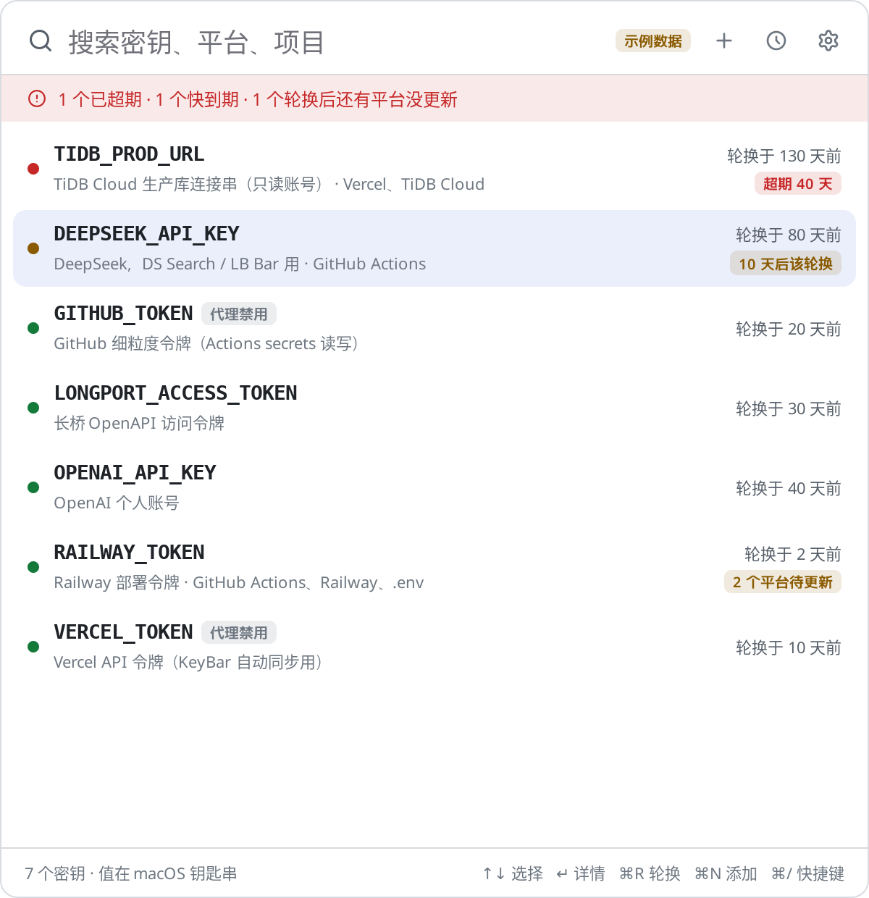
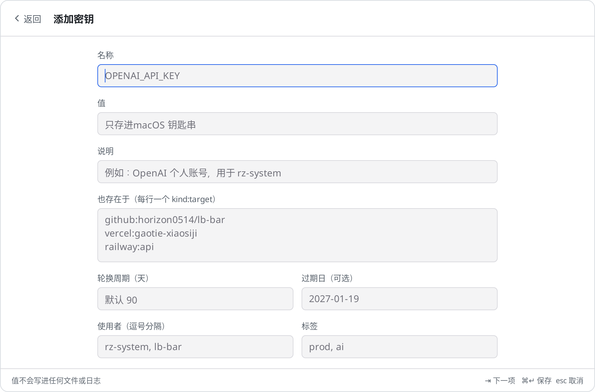
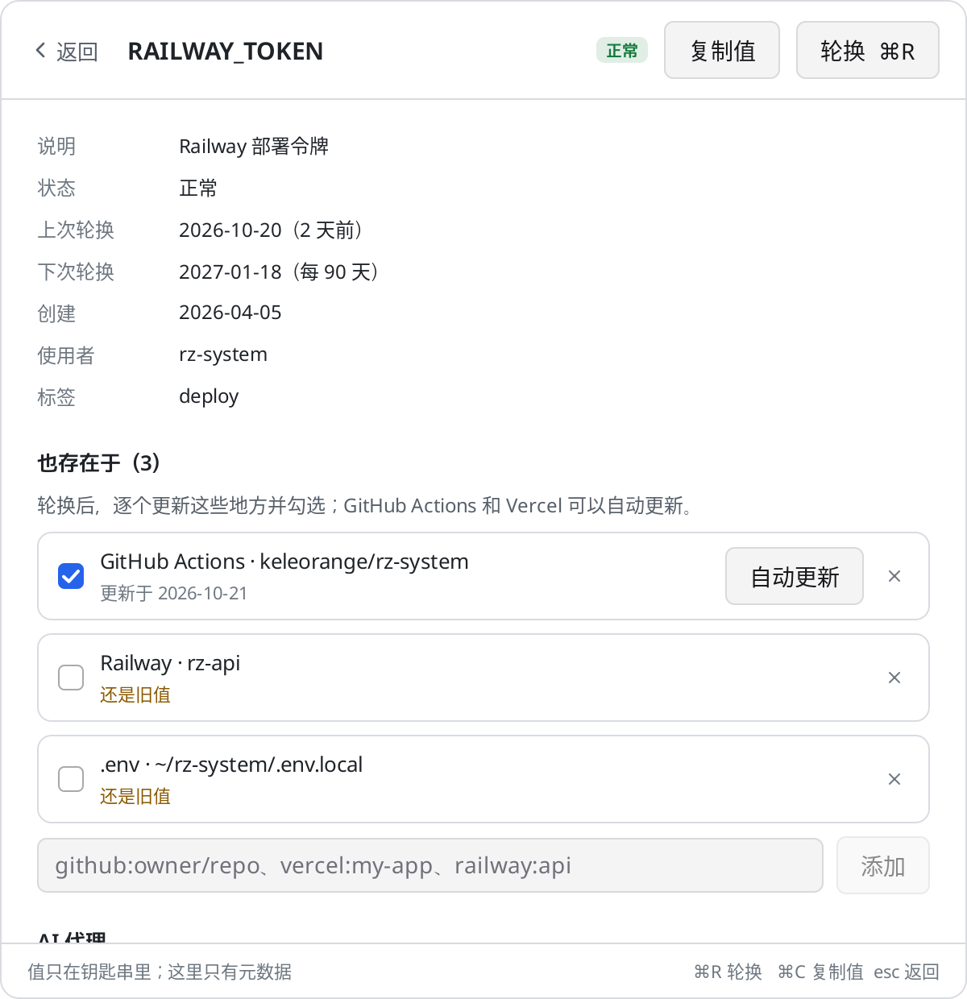
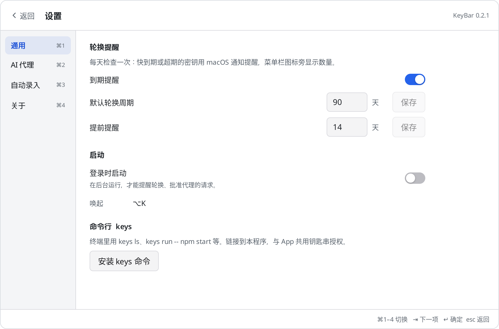
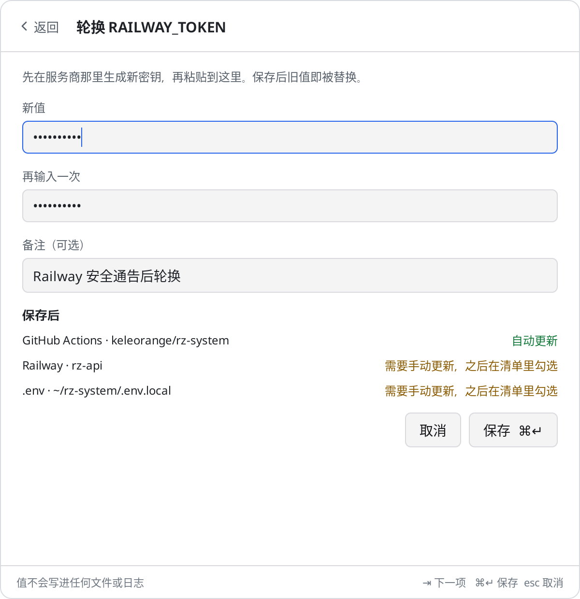
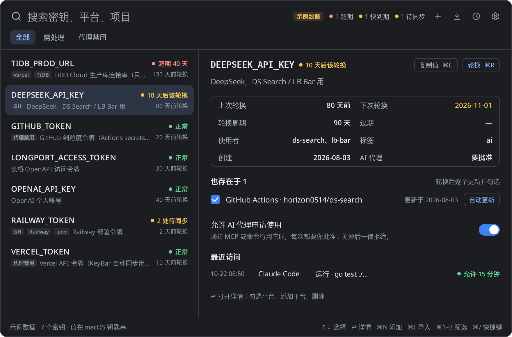
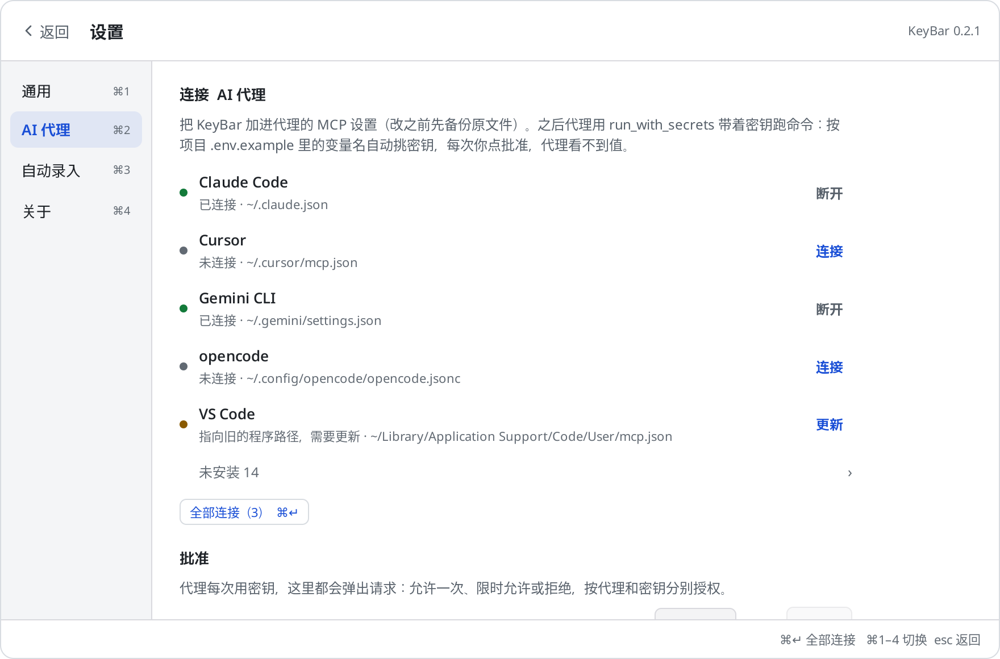

# KeyBar

几个 API key 的轻量钥匙串：**存、复制、轮换**。值只在系统钥匙串里；菜单栏里搜一下、`⌘C` 复制；到期点「自动轮换」，粘贴新值后 GitHub Actions / Vercel / 本地 `.env` 自动推送，其它平台进清单。

- **钥匙串**：macOS 钥匙串 / Windows 凭据管理器 / Linux Secret Service。KeyBar 自己的文件里只有名字、平台、日期，没有值。
- **菜单栏**：两栏清单 / 详情。添加只要名称 + 值（说明可选）；平台、轮换周期、标签在详情里以后再填。
- **自动轮换**：提醒或详情里一点 → 粘贴新值 → 能自动同步的平台（GitHub Actions、Vercel、本地 `.env`）马上推；其余（Railway、TiDB…）列成勾选清单。
- **扫描 / 连接代理（可选）**：扫描只认真正的 key（`*KEY*` / `*TOKEN*` / 认得出的格式），不把 `PORT` 推到脸上；连接代理优先显示已安装的。剪贴板检测、新 `.env` 提醒默认关闭。



| 添加（名称 + 值） | 详情与轮换 | 设置 |
|---|---|---|
|  |  |  |

| 轮换 | 深色列表 | 连接 AI 代理（可选） |
|---|---|---|
|  |  |  |

更多：[扫描本机](docs/screenshots/scan-light.png) · [导入](docs/screenshots/import-light.png) · [访问记录](docs/screenshots/log-light.png) · [快捷键](docs/screenshots/shortcuts-light.png) · [批准（MCP，可选）](docs/screenshots/approval-light.png)。

Linux 实机截图：[列表](docs/screenshots/linux-list.png) · [详情](docs/screenshots/linux-detail.png) · [端到端批准](docs/screenshots/linux-e2e-approval.png)。

## 为什么

供应链攻击（比如被投毒的 PyPI / npm 包）拿到的第一样东西就是 `os.environ` 和项目里的 `.env`。几个真正的 API key 不该和 `PORT`、`NODE_ENV` 挤在同一个明文文件里，也不该常驻在 shell 环境变量里。KeyBar 的做法：

1. 值只在钥匙串里，磁盘上没有明文副本；
2. 平时就是一个钥匙串列表：搜、复制、看上次轮换；
3. 到期或泄露时，粘贴新值 → 自动推到能推的平台，剩下的有清单；
4. 需要时才用 `keys run` / MCP：命令只拿到它要用的那几个 key，代理默认看不到明文，非交互访问要你批准并记日志。

## 安装

从 [Releases](../../releases) 下载：

| 系统 | 文件 |
|---|---|
| macOS（Intel + Apple 芯片） | `KeyBar-<版本>-macos-universal.zip`，解压后拖进“应用程序” |
| Windows x64 / arm64 | `KeyBar-<版本>-windows-<arch>-setup.exe`，或 `-portable.zip`（带 `keys.cmd`） |
| Linux x64 / arm64 | `keybar_<版本>_<arch>.deb`，或 `.tar.gz` |

macOS 版是 ad hoc 签名（标识 `dev.horizon.keybar`，签名要求只看标识），第一次打开需在“系统设置 → 隐私与安全性”里允许；之后升级，钥匙串仍认得它，不会反复弹授权。

打开 KeyBar → 设置 → 通用 →“安装 keys 命令”，会把 `keys` 链接到 PATH（`/opt/homebrew/bin`、`/usr/local/bin` 或 `~/.local/bin`；Windows 写 `keys.cmd`）。`keys` 和应用是同一个可执行文件，所以钥匙串授权是共享的。

快捷键：macOS `⌥K`，其它系统 `Alt+Shift+K`，可在设置里改。

## 三步上手

**1. 把 key 加进钥匙串**

菜单栏按 `⌘N`（或托盘「添加密钥」）：填**名称**和**值**，说明可选。平台、轮换周期、标签以后在详情里补。

已有 `.env` 时也可以一次收进来：

```sh
cd ~/code/my-app
keys import .env          # 或面板里 ⌘I；同名不同值会逐个问你
```

扫描本机（设置 › 自动录入 ›「扫描本机…」，或 `keys scan`）只勾选像密钥的项。

**2. 需要时复制**

清单里选中 → `⌘C`（约 30 秒后清剪贴板），或打开详情点「复制值」。

**3. 到期就轮换**

超期 / 快到期时菜单栏有角标，通知和托盘可以直接「自动轮换」：

1. 在服务商那里生成新密钥，粘贴进 KeyBar；
2. 保存后钥匙串更新；GitHub Actions / Vercel（需对应 token）和已记录的本地 `.env` 自动写回；
3. 其它平台留在详情的勾选清单里，改完勾掉。

```sh
keys rotate OPENAI_API_KEY
keys done OPENAI_API_KEY all
```

---

想让本地程序或 AI 代理经 KeyBar 取用，见下面的 [`keys run`](#命令行) 和[给 AI 代理用（MCP）](#给-ai-代理用mcp)——都是可选能力，不是上手必经之路。

## 自动录入（可选）

剪贴板检测和新 `.env` 提醒**默认关闭**，在设置 › 自动录入里打开。

**扫描本机**（设置 › 自动录入 ›「扫描本机…」、托盘菜单，或 `keys scan`）：在 `~/code`、`~/projects`、`~/dev`、`~/src`、`~/workspace`、`~/Documents/GitHub` 和主目录的第一层里找 `.env`、`.env.local`、`.env.*`（不含 `.example` / `.sample` / `.template`），跳过 `node_modules`、`.git`、`vendor`、`build`、`Library` 等和隐藏目录；再看 `~/.zshrc`、`~/.zshenv`、`~/.zprofile`、`~/.bashrc`、`~/.bash_profile`、`~/.profile`、fish 的 `config.fish` 里写死值的 `export NAME=value`（`$VAR`、`$(…)` 这种不算）。位置可以在设置里改。

结果按文件列成勾选清单，像密钥的已勾选：名字像（`*KEY*`、`*TOKEN*`、`*SECRET*`、`*PASSWORD*`、带密码的连接串），或值像（认得出的服务商格式、够长够乱），占位符（`your-key`、`changeme`、`<…>`）和 `PORT`、`NODE_ENV`、`NEXT_PUBLIC_*` 这类不算。值只显示前缀和长度（`sk-proj-… 164 位`）。重名的处理和导入一样：值相同跳过，值不同保留 / 覆盖 / 改名为 `NAME_项目名`；两个文件里同名不同值时，后一个默认改名。

导入后可以按文件选择**移除明文**（默认不移除）：`.env` 可以注释掉、只留变量名（`NAME=`）或删除整行；shell 配置的 `export` 行改成 `# moved to KeyBar: NAME…` 注释。改之前原文件存为 `*.keybar-backup`（0600，含明文，确认无误后自己删），写入是原子的，文件模式不变；只移除已经在 KeyBar 里的（选了“保留现有”的不动）。

```sh
keys scan                              # 只列出，不导入
keys scan --import                     # 导入打勾的（--all 全部，--on-conflict skip|overwrite|rename）
keys scan --import --clean names       # 导入后移除明文：comment | names | delete（先备份）
keys scan --roots ~/work,~/oss --no-rc # 换位置、不看 shell 配置
keys scan --file ~/code/my-app/.env --import
```

**剪贴板**：应用开着时每秒看一次剪贴板的变化计数（macOS `NSPasteboard changeCount`，Windows `GetClipboardSequenceNumber`；Linux 没有计数，每 2 秒用 `wl-paste` 或 `xclip` 读一次，比较哈希）。复制了认得出格式的 key、而 KeyBar 里没有这个值时，面板顶上出现一行「发现 OpenAI key · 保存为 OPENAI_API_KEY」，名字可改，`⌘S` 保存、或忽略；两分钟后自动消失。剪贴板内容不写日志、不落盘，只在你保存时进钥匙串。密码管理器标记为隐藏 / 临时的内容（`org.nspasteboard.ConcealedType`、`TransientType`，Windows `ExcludeClipboardContentFromMonitorProcessing`，KDE `x-kde-passwordManagerHint`）一律不看。认得的格式：OpenAI、Anthropic、OpenRouter、DeepSeek、GitHub、GitLab、Google、AWS、Stripe、Slack、Vercel、Hugging Face、Groq、xAI、Perplexity、Replicate、npm、Supabase、SendGrid、Linear、Notion、Fireworks。设置里可以关。

**缺 key 当场补上**：`keys run` 在终端里自动找变量时，项目要的、KeyBar 里没有的，逐个隐藏输入：

```
GROQ_API_KEY 不在 KeyBar，粘贴值保存，回车跳过（输入 - 以后不再问）：
keys：已存入 GROQ_API_KEY（gsk_… 56 位）
keys：注入 GROQ_API_KEY；KeyBar 里没有 NODE_ENV、PORT，跳过
```

代理（MCP `run_with_secrets`）或非交互的 `keys run` 请求时，批准面板里列出缺的变量，每个一个隐藏的粘贴框；粘贴的值由应用直接存进钥匙串（不经过代理和命令行），然后一起注入。`PORT`、`HOST`、`NODE_ENV`、`DEBUG`、`LOG_LEVEL` 这类明显不是密钥的不问；「不再询问」按项目记住（设置 › 自动录入里可恢复）。

**新的 `.env`**：应用每 20 秒看一次扫描位置里 `.env` 的修改时间（不用文件监听，改动停下 3 秒后才算），新出现或改过、并且有 KeyBar 里没有的密钥时，面板顶上和托盘菜单提示「my-app/.env 有 3 个新 key · 导入」；「忽略此文件」以后不再提醒。设置里可以关。

扫描、导入、移除明文、从剪贴板保存、补录都记在访问记录里（只有名字和文件路径）。

## 命令行

```sh
keys add OPENAI_API_KEY --desc "个人账号" --platform env:~/proj/.env --tag ai
#   值从隐藏提示或标准输入读，绝不从命令行参数读（参数会进 shell 历史和 ps）
pbpaste | keys add TIDB_PROD_URL --platform vercel:my-app --platform railway:api
keys ls                       # 只有元数据：状态、上次轮换、平台
keys show TIDB_PROD_URL       # 详情、平台清单、轮换历史
keys run -- npm run dev       # 自动注入项目要的
keys run -e OPENAI_API_KEY -e DATABASE_URL=TIDB_PROD_URL --redact -- python app.py
keys import .env --on-conflict rename --shred
keys scan --import --clean comment   # 扫描本机的 .env 和 shell 配置，导入像密钥的，移除明文（先备份）
keys rotate TIDB_PROD_URL     # 输入新值 → 自动同步 GitHub/Vercel → 列出要手动更新的平台
keys done TIDB_PROD_URL p2    # 勾掉一项（all：全部）
keys audit -n 20 --key TIDB_PROD_URL   # 访问记录
keys doctor ~/code            # 超期、快到期、未完成的清单、散落的明文 .env、这个项目会注入什么
keys get NAME --reveal        # 真要看明文时；会记日志，非交互时要批准
```

没有 `export`：KeyBar 不会把一批密钥写成明文文件。

### 平台

`--platform kind:target[:VAR][?env=a,b&team=T&token=KEY]`：

| kind | 例子 | 轮换时 |
|---|---|---|
| `github` | `github:owner/repo`、`github:owner/repo:DEPLOY_KEY?env=production` | 自动：用 KeyBar 里的 `GITHUB_TOKEN`（需 Secrets 写权限）加密后写入；没有就用 `gh secret set` |
| `vercel` | `vercel:my-app?env=production,preview&team=team_x` | 自动：用 KeyBar 里的 `VERCEL_TOKEN` |
| `env` | `env:~/proj/.env`、`env:~/proj/.env.local` | 自动：改文件里对应变量（先备份 `*.keybar-backup`） |
| 其它 | `railway:api`、`tidb:cluster-1`、`1password:…` | 列入清单，手动更新后勾掉 |

`token=KEY` 可以给某个平台指定别的 token key。同步用的 token 本身也是 KeyBar 里的 key，同样不出现在环境变量里。

### keys.toml（可选）

只有变量名和密钥名不一样时才需要，比如改名导入的、或者几个项目共用一个库但变量名不同：

```toml
# 环境变量名 = KeyBar 里的密钥名。没有值，可以提交。
[env]
DATABASE_URL = "TIDB_PROD_URL"
```

`keys run` 和 `run_with_secrets` 从当前目录往上找它，它的映射优先于自动检测。里面写了像真实密钥的值（`sk-…`、`ghp_…`、带 `:/@+=` 的长串）会直接报错。

## 给 AI 代理用（MCP，可选）

不是主路径。用得着时：`keys connect` 或设置 › AI 代理 ›「连接」。

### 支持的代理

设置里已安装的排在前面，没装的收在「未安装」下面。路径是 macOS / Linux 的；Windows 上 `~/Library/Application Support` 对应 `%APPDATA%`。

| 代理 | 设置文件 | 怎么改 |
|---|---|---|
| Claude Code | `~/.claude.json` → `mcpServers` | 有 `claude` 命令时用 `claude mcp add --scope user`，否则合并 JSON |
| Cursor | `~/.cursor/mcp.json` → `mcpServers` | 合并 JSON |
| Codex | `~/.codex/config.toml`（`$CODEX_HOME`）→ `[mcp_servers.keybar]` | 按行改 TOML，注释保留 |
| Gemini CLI | `~/.gemini/settings.json` → `mcpServers` | 合并 JSON（可带注释） |
| Qwen Code | `~/.qwen/settings.json` → `mcpServers` | 合并 JSON |
| opencode | `~/.config/opencode/opencode.json`（或 `.jsonc`）→ `mcp`，`type: local`，`command` 是数组 | 合并 JSONC，注释保留 |
| pi | `~/.pi/agent/mcp.json` → `mcpServers`（pi 0.99 起内置 MCP） | 用 `pi mcp add`，老版本没有这个命令就合并 JSON |
| Kimi Code | `~/.kimi-code/mcp.json`（旧版 Kimi CLI：`~/.kimi/mcp.json`）→ `mcpServers` | 合并 JSON |
| iFlow CLI | `~/.iflow/settings.json` → `mcpServers` | 合并 JSON |
| Crush | `~/.config/crush/crush.json` → `mcp`，`type: stdio` | 合并 JSON（Windows 暂不支持） |
| Amp | `~/.config/amp/settings.json` → `amp.mcpServers` | 合并 JSON |
| Goose | `~/.config/goose/config.yaml` → `extensions.keybar`（`type: stdio`） | 按行改 YAML，改完逐项核对（Windows 暂不支持） |
| DeepSeek Harness（`dsh`） | `~/.dsh/cordis.patch.yml`（`$DSH_HOME`）：一条 `insert` 补丁挂 `@deepseek-ai/dsh-mcp-client` | 在标记注释之间加一段 YAML，改完核对 |
| Claude Desktop | `~/Library/Application Support/Claude/claude_desktop_config.json` → `mcpServers` | 合并 JSON（Linux 没有） |
| VS Code（GitHub Copilot） | `~/Library/Application Support/Code/User/mcp.json` → `servers`，`type: stdio` | 合并 JSONC |
| Windsurf | `~/.codeium/windsurf/mcp_config.json` → `mcpServers` | 合并 JSON |
| Zed | `~/.config/zed/settings.json` → `context_servers` | 合并 JSONC，注释保留 |
| Kiro | `~/.kiro/settings/mcp.json` → `mcpServers` | 合并 JSON |
| Cline（VS Code 扩展） | `…/Code/User/globalStorage/saoudrizwan.claude-dev/settings/cline_mcp_settings.json` → `mcpServers` | 合并 JSON |

JSON 文件允许注释和结尾逗号（JSONC）：KeyBar 直接在原文上插入或删掉 `keybar` 这一段，其它字节不动；改完把前后两份解析出来比对，除了 `keybar` 有任何不同就放弃、不写。

其它支持 MCP 的代理：命令是 KeyBar 程序（macOS `/Applications/KeyBar.app/Contents/MacOS/KeyBar`，Linux/Windows 是 `keys` 或 `KeyBar.exe` 的完整路径），参数 `mcp --client 名字`；设置里可以复制这段 JSON，也见 [examples/](examples/)。

工具：

| 工具 | 作用 | 批准 |
|---|---|---|
| `run_with_secrets` | **主要用这个**。带着 key 跑命令（数组或一行命令，`cwd` 设成项目目录）：不传 `keys` 就按项目的 `.env.example` / `.env` 自动挑；返回退出码和脱敏后的输出。代理被禁用的 key 不会注入 | 需要 |
| `list_keys` | 列出 key 的名字、说明、状态、平台（没有值） | 不需要 |
| `request_secret` | 拿明文值。工具说明里就写着不推荐；批准界面会用醒目的颜色提示 | 需要 |

批准流程：菜单栏应用开着时，请求出现在面板里（`Enter` 允许一次，`⌘Enter`/`Ctrl+Enter` 允许 N 分钟，`Esc` 拒绝，出现后 0.6 秒内的按键会被忽略，防止误触）；应用没开时退回到系统对话框（macOS `osascript`，Linux `zenity`/`kdialog`，Windows 消息框）；都没有就拒绝。2 分钟没回答自动拒绝。某个 key 设成 `--agent deny` 后，代理一律不能用它。

脱敏：原值、去掉首尾空白的值、标准和 URL 安全的 base64、URL 编码形式，都会被替换；流式输出跨块也能识别。脱敏挡的是“不小心打印出来”，挡不住故意变形（比如逐字符输出）——所以请求明文和运行命令都要你批准，并且命令原样显示在批准界面上。

## 威胁模型

能防的：
- 依赖或工具读取环境变量、扫描 `.env`：key 不在环境里，也不在磁盘上；
- 代理在对话里看到、记下、提交 key：默认它只拿到脱敏输出；
- 不知道谁在什么时候用了哪个 key：访问记录；
- 泄露后手忙脚乱：轮换清单和自动同步。

不能防的：
- 你批准运行的命令本身是恶意的：它在自己的进程里拿得到值；
- 以你的用户身份运行、并能操作你钥匙串或屏幕的恶意软件；
- `keys run` 不加 `--redact` 时，命令输出原样打印（在终端里是你自己看；被脚本或代理调用时批准界面会特别提醒）。

一些细节：
- 数据目录：macOS `~/Library/Application Support/KeyBar`，Windows `%APPDATA%\KeyBar`，Linux `~/.config/keybar`（`KEYBAR_DIR` 可改）。里面是 `inventory.json`（元数据）、`settings.json`、`audit.jsonl`（访问记录，4MB 滚动）、`ipc.json`，都是 0600。
- 命令行和应用之间通过 127.0.0.1 上的随机端口加随机令牌通信（令牌在 0600 的 `ipc.json` 里）。
- “允许 N 分钟”只存在内存里，应用退出即失效。
- 非交互使用 `keys get/run` 时需要批准（`cli-approval`，默认开）；这个设置只能在真正的终端里关，代理的 shell 关不掉。
- 钥匙串单个值上限 2560 字节。

## 开发

```sh
go test ./...                          # 单元测试：内存钥匙串，只用 dummy 值
KEYBAR_DOCS=1 go test -run TestScreenshots .   # 重新生成 docs/screenshots
go tool mygo build -platform linux/amd64      # 或 darwin/universal、windows/amd64……
bash scripts/e2e-linux.sh build/linux-amd64/keybar   # Linux 端到端：真实 Secret Service + 应用里批准
bash scripts/screenshot-linux.sh build/linux-amd64/keybar build/screenshots
KEYBAR_DEMO=1 go run .                  # 示例数据（内存钥匙串），不碰真实钥匙串
```

纯 Go（`CGO_ENABLED=0`），界面是 [MyGo](https://github.com/egoist/mygo) 原生 UI。打 `v*` 标签后 GitHub Actions 会在各系统上测试、打包并发布。

## English

KeyBar is a lightweight keychain for a few API keys: **store, copy, rotate**. Values live in the OS keychain (macOS Keychain, Windows Credential Manager, Linux Secret Service); metadata (where else each key lives, last rotation) stays in KeyBar's own files.

- Add a key with just a name and value (optional description). Platforms, rotate interval, tags live on the detail page.
- Copy with `⌘C`. When a key is due, one-tap **自动轮换**: paste the new value, KeyBar updates the keychain, pushes to GitHub Actions secrets, Vercel env vars, and local `.env` files when it can, and leaves a checklist for everything else.
- Optional: `keys scan` / Settings → 自动录入 (clipboard watch and new-`.env` notices default **off**); `keys run` and MCP `keys connect` for people who want injection / agent approval — not the main path.
- There is deliberately no `export`. Multi-device sync is out of scope for now.

Download from Releases, open KeyBar, Settings → “安装 keys 命令”, then add a couple of keys and copy when you need them. MIT licensed.
