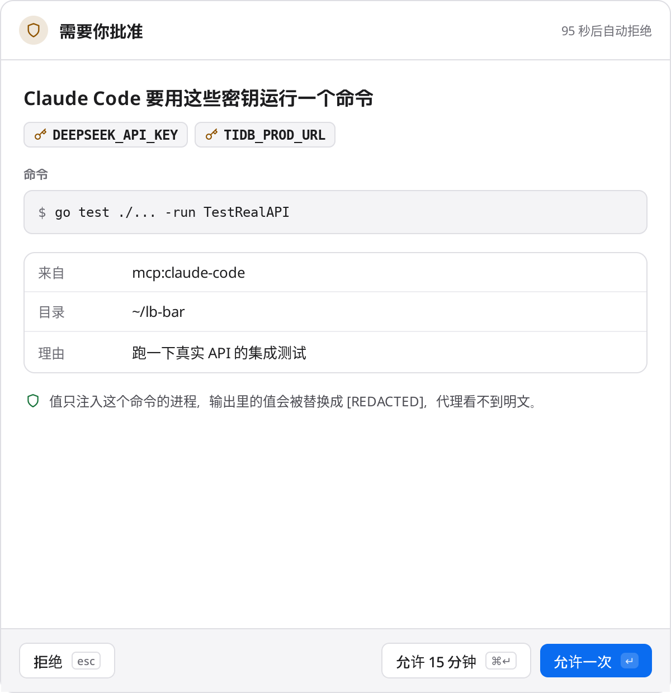
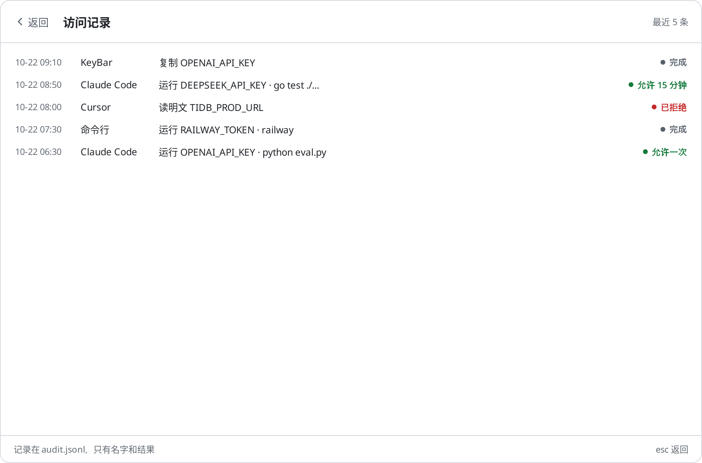
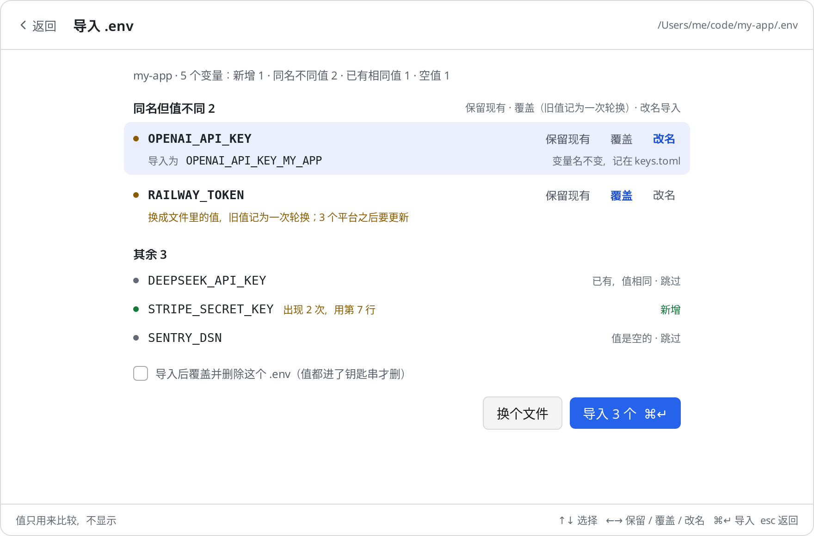

# KeyBar

把 API key 从 `.env` 和 shell 环境变量里搬出来：**值只存在系统钥匙串里**，程序和 AI 代理用的时候临时注入、要你点头，用完不留痕；同时记着每个 key 还存在哪些平台、什么时候该轮换。

- **钥匙串**：macOS 钥匙串 / Windows 凭据管理器 / Linux Secret Service（GNOME Keyring、KWallet）。KeyBar 自己的文件里只有元数据，没有值。
- **不用写配置**：密钥名就是环境变量名。`keys run` 看项目的 `.env.example` / `.env` 里有哪些变量名，KeyBar 里有同名的就注入。
- **一键连接 AI 代理**：设置里点一下（或 `keys connect`），KeyBar 就加进已安装的 AI 代理和编辑器的 MCP 设置（Claude Code、Cursor、Codex、Gemini CLI、opencode、pi 等 19 种，见[下表](#支持的代理)）。代理用 `run_with_secrets` 带着 key 跑命令，输出里的值被替换成 `[REDACTED:NAME]`。每次使用都要你在菜单栏里批准，全部记日志。
- **导入 `.env`**：同名但值不同时逐个决定：保留现有、覆盖（记为一次轮换）、或改名导入。
- **菜单栏 / 托盘**：键盘优先的两栏面板（左边清单、右边详情，`⌘1` `⌘2` `⌘3` 切换“全部 / 需处理 / 代理禁用”），批准请求、查看清单、轮换；每天提醒超期和快到期的 key，图标上有角标。
- **轮换清单**：换新值后自动更新 GitHub Actions secrets 和 Vercel 环境变量，其余平台（Railway、TiDB Cloud、`.env`……）列成清单逐个勾掉。


| 详情与平台清单 | 代理请求批准 | 访问记录 |
|---|---|---|
|  |  |  |

| 连接 AI 代理 | 导入时的同名冲突 | 深色 |
|---|---|---|
|  |  |  |

更多：[轮换](docs/screenshots/rotate-light.png) · [快捷键](docs/screenshots/shortcuts-light.png) · [搜索无结果](docs/screenshots/empty-search-dark.png) · [添加](docs/screenshots/add-light.png) · [导入](docs/screenshots/import-light.png)。

Linux（Xvfb + openbox）实机截图：[列表](docs/screenshots/linux-list.png) · [详情](docs/screenshots/linux-detail.png) · [端到端测试里 MCP 请求的批准](docs/screenshots/linux-e2e-approval.png) · [命令行请求（输出不脱敏的提醒）](docs/screenshots/linux-e2e-cli-approval.png)。

## 为什么

供应链攻击（比如被投毒的 PyPI / npm 包）拿到的第一样东西就是 `os.environ` 和项目里的 `.env`。把所有 key 常驻在 shell 环境变量里，等于让每个子进程、每个依赖、每个 AI 代理都能读到全部 key。KeyBar 的做法：

1. 值只在钥匙串里，磁盘上没有明文副本；
2. 一个命令只拿到它的项目用到的那几个 key（`.env.example` 里列出的名字），而且只在它的进程里；
3. 代理默认看不到值：它让 KeyBar 去跑命令，拿回脱敏后的输出；
4. 非交互的访问（代理、脚本）都要你批准，可以“允许一次”“允许 15 分钟”或拒绝，按“客户端 × key”分别记；
5. 每次访问写进访问记录；
6. 被通报泄露时，`keys rotate` 一条命令换值、同步到能自动同步的平台，剩下的列清单。

## 安装

从 [Releases](../../releases) 下载：

| 系统 | 文件 |
|---|---|
| macOS（Intel + Apple 芯片） | `KeyBar-<版本>-macos-universal.zip`，解压后拖进“应用程序” |
| Windows x64 / arm64 | `KeyBar-<版本>-windows-<arch>-setup.exe`，或 `-portable.zip`（带 `keys.cmd`） |
| Linux x64 / arm64 | `keybar_<版本>_<arch>.deb`，或 `.tar.gz` |

macOS 版是 ad hoc 签名（标识 `dev.horizon.keybar`，签名要求只看标识），第一次打开需在“系统设置 → 隐私与安全性”里允许；之后升级，钥匙串仍认得它，不会反复弹授权。

打开 KeyBar → 设置 → 通用 →“安装 keys 命令”，会把 `keys` 链接到 PATH（`/opt/homebrew/bin`、`/usr/local/bin` 或 `~/.local/bin`；Windows 写 `keys.cmd`）。`keys` 和应用是同一个可执行文件，所以钥匙串授权是共享的。

快捷键：macOS `⌥K`，其它系统 `Alt+Shift+K`，可在设置里改。

## 三步上手

**1. 把 `.env` 收进钥匙串**

```sh
cd ~/code/my-app
keys import .env          # 或在面板里按 ⌘I
```

变量名就是密钥名。遇到 KeyBar 里已有的名字：

- 值相同：直接跳过（只计数）；
- 值不同：逐个问你——`k` 保留现有、`o` 覆盖（旧值记为一次轮换，其它平台进清单）、`r` 改名导入（默认 `名字_项目名`，比如 `OPENAI_API_KEY_MY_APP`，可以改）。改名的会记进项目的 `keys.toml`，`keys run` 仍按原来的变量名注入；
- 同一个文件里重复的变量：用最后一个，并提示你。

没有终端时（脚本、代理）不会问，用 `--on-conflict skip|overwrite|rename` 指定，默认 `skip` 并在最后汇总。值从不打印，只在比较时读取。全部导入后可以 `--shred` 覆盖并删除 `.env`。

**2. 运行程序**

```sh
keys run -- npm run dev
```

不用写任何配置：`keys run` 从当前目录往上到 git 仓库根，读 `.env.example`、`.env.sample`、`.env`（以及 `.env.template`、`.env.local`）里的**变量名**（不读值），KeyBar 里有同名密钥的就注入到这个进程；没有的跳过，并在 stderr 提一句。想指定就 `-e NAME` 或 `-e DATABASE_URL=TIDB_PROD_URL`。

**3. 连接 AI 代理**

设置 → AI 代理 →「连接」（`⌘↵` 全部连接），或：

```sh
keys connect              # 连接所有已安装的（列表见下表）
keys connect --status     # ● 已连接  ○ 未连接
keys connect opencode zed # 只连这几个
keys disconnect cursor
```

它把 `keybar` 这一项加进每个代理自己的 MCP 设置（路径见[下表](#支持的代理)）：只改 `keybar` 这一项，其它设置和注释原样保留，改之前把原文件备份成 `*.keybar-backup`，写入是原子的，已经连好就什么都不写；文件读不懂就不改并告诉你。重启代理（或开新会话）后，代理这样用：

> 你：跑一下集成测试
>
> 代理 → `run_with_secrets {"command": "npm test", "cwd": "/Users/me/code/my-app"}`
>
> KeyBar 弹出批准：Claude Code 要用 OPENAI_API_KEY、DATABASE_URL 运行 `npm test` → 你按 `↵`
>
> 代理拿到：`injected: DATABASE_URL, OPENAI_API_KEY` + 退出码 + 输出（值都是 `[REDACTED:…]`）

## 命令行

```sh
keys add OPENAI_API_KEY --desc "个人账号" --platform env:~/proj/.env --tag ai
#   值从隐藏提示或标准输入读，绝不从命令行参数读（参数会进 shell 历史和 ps）
pbpaste | keys add TIDB_PROD_URL --platform vercel:my-app --platform railway:api
keys ls                       # 只有元数据：状态、上次轮换、平台
keys show TIDB_PROD_URL       # 详情、平台清单、轮换历史
keys run -- npm run dev       # 自动注入项目要的
keys run -e OPENAI_API_KEY -e DATABASE_URL=TIDB_PROD_URL --redact -- python app.py
keys import .env --on-conflict rename --shred
keys rotate TIDB_PROD_URL     # 输入新值 → 自动同步 GitHub/Vercel → 列出要手动更新的平台
keys done TIDB_PROD_URL p2    # 勾掉一项（all：全部）
keys audit -n 20 --key TIDB_PROD_URL   # 访问记录
keys doctor ~/code            # 超期、快到期、未完成的清单、散落的明文 .env、这个项目会注入什么
keys get NAME --reveal        # 真要看明文时；会记日志，非交互时要批准
```

没有 `export`：KeyBar 不会把一批密钥写成明文文件。

### 平台

`--platform kind:target[:VAR][?env=a,b&team=T&token=KEY]`：

| kind | 例子 | 轮换时 |
|---|---|---|
| `github` | `github:owner/repo`、`github:owner/repo:DEPLOY_KEY?env=production` | 自动：用 KeyBar 里的 `GITHUB_TOKEN`（需 Secrets 写权限）加密后写入；没有就用 `gh secret set` |
| `vercel` | `vercel:my-app?env=production,preview&team=team_x` | 自动：用 KeyBar 里的 `VERCEL_TOKEN` |
| 其它 | `railway:api`、`tidb:cluster-1`、`env:~/proj/.env`、`1password:…` | 列入清单，手动更新后勾掉 |

`token=KEY` 可以给某个平台指定别的 token key。同步用的 token 本身也是 KeyBar 里的 key，同样不出现在环境变量里。

### keys.toml（可选）

只有变量名和密钥名不一样时才需要，比如改名导入的、或者几个项目共用一个库但变量名不同：

```toml
# 环境变量名 = KeyBar 里的密钥名。没有值，可以提交。
[env]
DATABASE_URL = "TIDB_PROD_URL"
```

`keys run` 和 `run_with_secrets` 从当前目录往上找它，它的映射优先于自动检测。里面写了像真实密钥的值（`sk-…`、`ghp_…`、带 `:/@+=` 的长串）会直接报错。

## 给 AI 代理用（MCP）

用 `keys connect` 或设置里的「连接」即可。

### 支持的代理

设置里已安装的排在前面，没装的收在「未安装」下面。路径是 macOS / Linux 的；Windows 上 `~/Library/Application Support` 对应 `%APPDATA%`。

| 代理 | 设置文件 | 怎么改 |
|---|---|---|
| Claude Code | `~/.claude.json` → `mcpServers` | 有 `claude` 命令时用 `claude mcp add --scope user`，否则合并 JSON |
| Cursor | `~/.cursor/mcp.json` → `mcpServers` | 合并 JSON |
| Codex | `~/.codex/config.toml`（`$CODEX_HOME`）→ `[mcp_servers.keybar]` | 按行改 TOML，注释保留 |
| Gemini CLI | `~/.gemini/settings.json` → `mcpServers` | 合并 JSON（可带注释） |
| Qwen Code | `~/.qwen/settings.json` → `mcpServers` | 合并 JSON |
| opencode | `~/.config/opencode/opencode.json`（或 `.jsonc`）→ `mcp`，`type: local`，`command` 是数组 | 合并 JSONC，注释保留 |
| pi | `~/.pi/agent/mcp.json` → `mcpServers`（pi 0.99 起内置 MCP） | 用 `pi mcp add`，老版本没有这个命令就合并 JSON |
| Kimi Code | `~/.kimi-code/mcp.json`（旧版 Kimi CLI：`~/.kimi/mcp.json`）→ `mcpServers` | 合并 JSON |
| iFlow CLI | `~/.iflow/settings.json` → `mcpServers` | 合并 JSON |
| Crush | `~/.config/crush/crush.json` → `mcp`，`type: stdio` | 合并 JSON（Windows 暂不支持） |
| Amp | `~/.config/amp/settings.json` → `amp.mcpServers` | 合并 JSON |
| Goose | `~/.config/goose/config.yaml` → `extensions.keybar`（`type: stdio`） | 按行改 YAML，改完逐项核对（Windows 暂不支持） |
| DeepSeek Harness（`dsh`） | `~/.dsh/cordis.patch.yml`（`$DSH_HOME`）：一条 `insert` 补丁挂 `@deepseek-ai/dsh-mcp-client` | 在标记注释之间加一段 YAML，改完核对 |
| Claude Desktop | `~/Library/Application Support/Claude/claude_desktop_config.json` → `mcpServers` | 合并 JSON（Linux 没有） |
| VS Code（GitHub Copilot） | `~/Library/Application Support/Code/User/mcp.json` → `servers`，`type: stdio` | 合并 JSONC |
| Windsurf | `~/.codeium/windsurf/mcp_config.json` → `mcpServers` | 合并 JSON |
| Zed | `~/.config/zed/settings.json` → `context_servers` | 合并 JSONC，注释保留 |
| Kiro | `~/.kiro/settings/mcp.json` → `mcpServers` | 合并 JSON |
| Cline（VS Code 扩展） | `…/Code/User/globalStorage/saoudrizwan.claude-dev/settings/cline_mcp_settings.json` → `mcpServers` | 合并 JSON |

JSON 文件允许注释和结尾逗号（JSONC）：KeyBar 直接在原文上插入或删掉 `keybar` 这一段，其它字节不动；改完把前后两份解析出来比对，除了 `keybar` 有任何不同就放弃、不写。

其它支持 MCP 的代理：命令是 KeyBar 程序（macOS `/Applications/KeyBar.app/Contents/MacOS/KeyBar`，Linux/Windows 是 `keys` 或 `KeyBar.exe` 的完整路径），参数 `mcp --client 名字`；设置里可以复制这段 JSON，也见 [examples/](examples/)。

工具：

| 工具 | 作用 | 批准 |
|---|---|---|
| `run_with_secrets` | **主要用这个**。带着 key 跑命令（数组或一行命令，`cwd` 设成项目目录）：不传 `keys` 就按项目的 `.env.example` / `.env` 自动挑；返回退出码和脱敏后的输出。代理被禁用的 key 不会注入 | 需要 |
| `list_keys` | 列出 key 的名字、说明、状态、平台（没有值） | 不需要 |
| `request_secret` | 拿明文值。工具说明里就写着不推荐；批准界面会用醒目的颜色提示 | 需要 |

批准流程：菜单栏应用开着时，请求出现在面板里（`Enter` 允许一次，`⌘Enter`/`Ctrl+Enter` 允许 N 分钟，`Esc` 拒绝，出现后 0.6 秒内的按键会被忽略，防止误触）；应用没开时退回到系统对话框（macOS `osascript`，Linux `zenity`/`kdialog`，Windows 消息框）；都没有就拒绝。2 分钟没回答自动拒绝。某个 key 设成 `--agent deny` 后，代理一律不能用它。

脱敏：原值、去掉首尾空白的值、标准和 URL 安全的 base64、URL 编码形式，都会被替换；流式输出跨块也能识别。脱敏挡的是“不小心打印出来”，挡不住故意变形（比如逐字符输出）——所以请求明文和运行命令都要你批准，并且命令原样显示在批准界面上。

## 威胁模型

能防的：
- 依赖或工具读取环境变量、扫描 `.env`：key 不在环境里，也不在磁盘上；
- 代理在对话里看到、记下、提交 key：默认它只拿到脱敏输出；
- 不知道谁在什么时候用了哪个 key：访问记录；
- 泄露后手忙脚乱：轮换清单和自动同步。

不能防的：
- 你批准运行的命令本身是恶意的：它在自己的进程里拿得到值；
- 以你的用户身份运行、并能操作你钥匙串或屏幕的恶意软件；
- `keys run` 不加 `--redact` 时，命令输出原样打印（在终端里是你自己看；被脚本或代理调用时批准界面会特别提醒）。

一些细节：
- 数据目录：macOS `~/Library/Application Support/KeyBar`，Windows `%APPDATA%\KeyBar`，Linux `~/.config/keybar`（`KEYBAR_DIR` 可改）。里面是 `inventory.json`（元数据）、`settings.json`、`audit.jsonl`（访问记录，4MB 滚动）、`ipc.json`，都是 0600。
- 命令行和应用之间通过 127.0.0.1 上的随机端口加随机令牌通信（令牌在 0600 的 `ipc.json` 里）。
- “允许 N 分钟”只存在内存里，应用退出即失效。
- 非交互使用 `keys get/run` 时需要批准（`cli-approval`，默认开）；这个设置只能在真正的终端里关，代理的 shell 关不掉。
- 钥匙串单个值上限 2560 字节。

## 开发

```sh
go test ./...                          # 单元测试：内存钥匙串，只用 dummy 值
KEYBAR_DOCS=1 go test -run TestScreenshots .   # 重新生成 docs/screenshots
go tool mygo build -platform linux/amd64      # 或 darwin/universal、windows/amd64……
bash scripts/e2e-linux.sh build/linux-amd64/keybar   # Linux 端到端：真实 Secret Service + 应用里批准
bash scripts/screenshot-linux.sh build/linux-amd64/keybar build/screenshots
KEYBAR_DEMO=1 go run .                  # 示例数据（内存钥匙串），不碰真实钥匙串
```

纯 Go（`CGO_ENABLED=0`），界面是 [MyGo](https://github.com/egoist/mygo) 原生 UI。打 `v*` 标签后 GitHub Actions 会在各系统上测试、打包并发布。

## English

KeyBar keeps API keys in the OS keychain (macOS Keychain, Windows Credential Manager, Linux Secret Service) instead of `.env` files and shell environments, and tracks where else each key lives and when it is due for rotation.

- `keys import .env` moves a project's keys into the keychain; for names it already has with a different value it asks per key: keep, overwrite (recorded as a rotation) or import under a new name (`NAME_PROJECT` by default). Without a terminal, `--on-conflict skip|overwrite|rename` (default skip).
- `keys run -- cmd` needs no config: it reads the variable names (never values) in `.env.example` / `.env.sample` / `.env` from the current folder up to the git root and injects the keys KeyBar holds under those names into that one process; `keys.toml` (names only) can map a variable to a differently named key. `--redact` scrubs values from its output.
- `keys connect` (or Settings → AI 代理 → 连接) adds KeyBar's MCP server to every installed agent it knows — Claude Code, Cursor, Codex, Gemini CLI, Qwen Code, opencode, pi, Kimi Code, iFlow CLI, Crush, Amp, Goose, DeepSeek Harness, Claude Desktop, VS Code, Windsurf, Zed, Kiro, Cline — merging into their settings (JSONC comments kept, TOML/YAML edited in place) with a backup, refusing files it cannot parse. Agents call `run_with_secrets` (keys auto-detected from the project, output redacted); `list_keys` gives metadata only; `request_secret` (raw value) is discouraged. Every use needs approval in the menu bar app (allow once / allow N minutes / deny, per client and key), falling back to a system dialog, and is written to the access log.
- `keys rotate` stores a new value, pushes it to GitHub Actions secrets and Vercel env vars, and lists every other place to update as a checklist.
- A menu bar / tray app (keyboard first) shows the inventory, approves requests, and reminds you daily of overdue keys.
- There is deliberately no `export`.

Download from Releases, open KeyBar, and use Settings → “安装 keys 命令” to put `keys` on your PATH, then `keys import .env`, `keys run -- <cmd>`, `keys connect`. MIT licensed.
